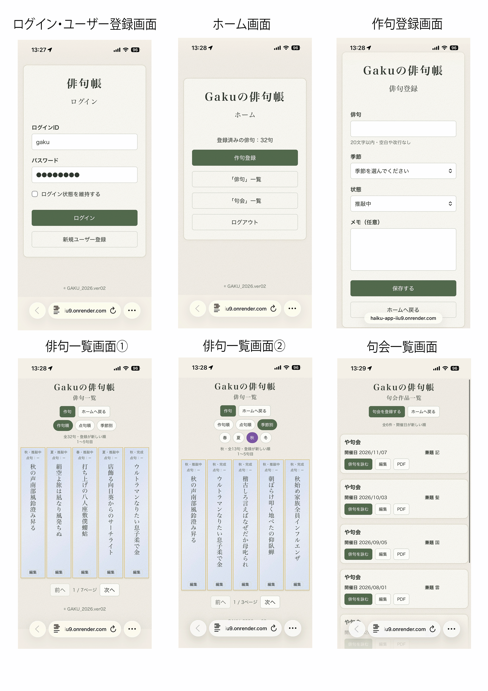
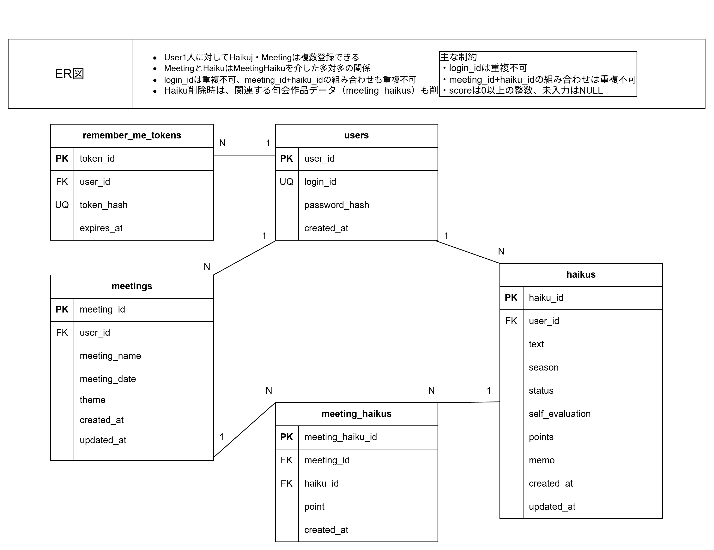
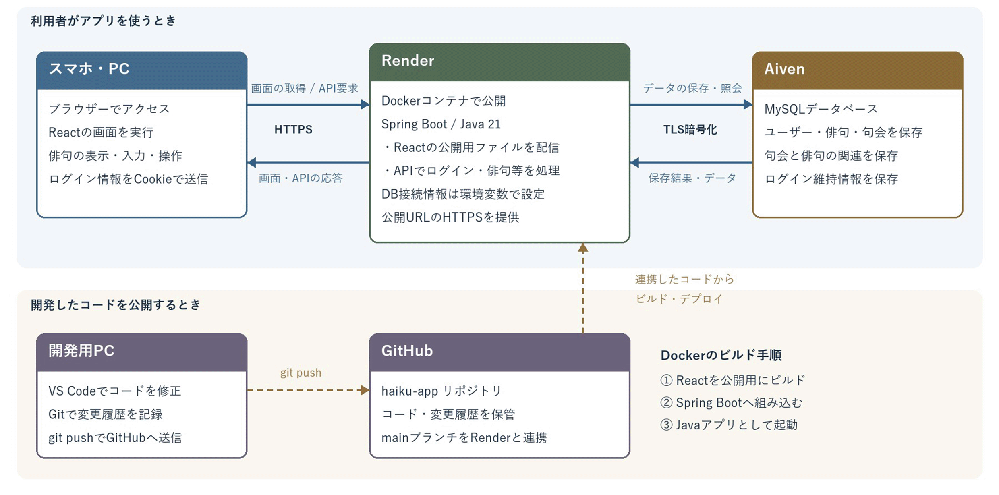

【タイトル・キャッチコピー】
「わたしの俳句帳」
あなたの俳句生活をもっと豊かで便利なものにします。

【アプリケーションのURL】
https://haiku-app-iiu9.onrender.com/

TestID:gaku
Pass:08190819

【アプリケーションのデモ画像】


【アプリケーションの概要】
日々に思い浮かんだ俳句をその場で記載、管理、推敲が簡単に出来ます。
また作句した俳句管理はもちろん各句会の管理、登録俳句一覧をPDF化する事も可能です。

【開発した背景や理由】
私の趣味の一つに俳句があります。俳句会にも参加させて頂いているのですが、
俳句が思い浮かんだ時にメモ帳や筆記用具が無い。忘れてしまう前にスマホのメモ機能に書き留めたりLINEのKeepメモに記載しますが、後で確認しようとすると何処にメモしたのか探す事から始めなくてはなりませんでした。そこで簡単に俳句を登録し、修正したり季節ごとに管理出来ればもっと俳句に寄り添う事が出来るのではないか。そんな思いで開発いたしました。
そして自分以外のユーザーが使用する事を意識して制作する事により、直観的に操作が出来るようにする。その事によって自分でも使いやすいアプリになると考えました。

また使用場面をスマホでの使用を想定し、スマホでの画面表示が正常になるようにサイズ調整し、俳句らしい縦表記と簡素ながらも俳句らしいデザインを意識して作った。実機で表示や動作を確認しながら気が付いた点をトライ&エラーを繰り返しながら調整している。
句会一覧から登録された俳句を外しても元の俳句が消えないように句会への追加情報は元の俳句とは分けて管理した。今後は作品や句会数が多くなった時の検索機能の強化をしていきたいと思う。

【主な使⽤技術】
フロントエンド JavaScript,React,HTML,CSS
バックエンド Java21,Spring Boot,Spring Data JPA
認証 　　　　セッション認証、BCryptによるパスワードのハッシュ化
データベース MySQL
インフラ 　　Render,Aiven,Docker
ビルドツール Maven,npm,Vite
バージョン管理 Git,GitHub
開発ツール 　　Visual Studio Code

【ER図】


【インフラ構成図】


【ローカル環境での起動⽅法】

### 必要な環境

- Java 21（JDK）
- Node.js 24・npm
- Git
- Docker Desktop

以下はWindowsのPowerShellでの実行例です。

### 1. リポジトリを取得する

```powershell
git clone https://github.com/kobatakenew-create/haiku-app.git
cd haiku-app
```

### 2. データベースを起動する

Docker Desktopを起動してから実行します。

```powershell
docker compose -f compose.local.yaml up -d --wait
```

MySQLをlocalhostの3307番ポートで起動します。
本番のAivenには接続せず、ローカル専用のDBを使用します。

### 3. バックエンドを起動する

同じターミナルで実行します。
Java 21が利用できる状態にしておいてください。

```powershell
$env:SPRING_PROFILES_ACTIVE = 'default'
$env:SPRING_DATASOURCE_URL = 'jdbc:mysql://localhost:3307/haiku_db'
$env:SPRING_DATASOURCE_USERNAME = 'haiku_user'
$env:SPRING_DATASOURCE_PASSWORD = 'local_haiku_example_2026'
.\mvnw.cmd spring-boot:run
```

バックエンドは http://localhost:8080 で起動します。
起動時に必要なテーブルが作成されます。

記載したパスワードはローカル確認用のサンプル値です。

### 4. フロントエンドを起動する

別のターミナルで、取得したhaiku-appフォルダーに移動して実行します。

```powershell
cd frontend
npm ci
npm run dev -- --port 5173 --strictPort
```

ブラウザーで http://localhost:5173/ を開いてください。

新規ユーザー登録後、ログインして利用できます。
本番サイトのアカウントや俳句は、ローカルDBには入っていません。

### 停止方法

バックエンド・フロントエンドは、それぞれのターミナルで
Ctrl＋Cを押して停止します。

DBはhaiku-app直下で次を実行して停止します。

```powershell
docker compose -f compose.local.yaml down
```

DBのデータは停止後も保持されます。
